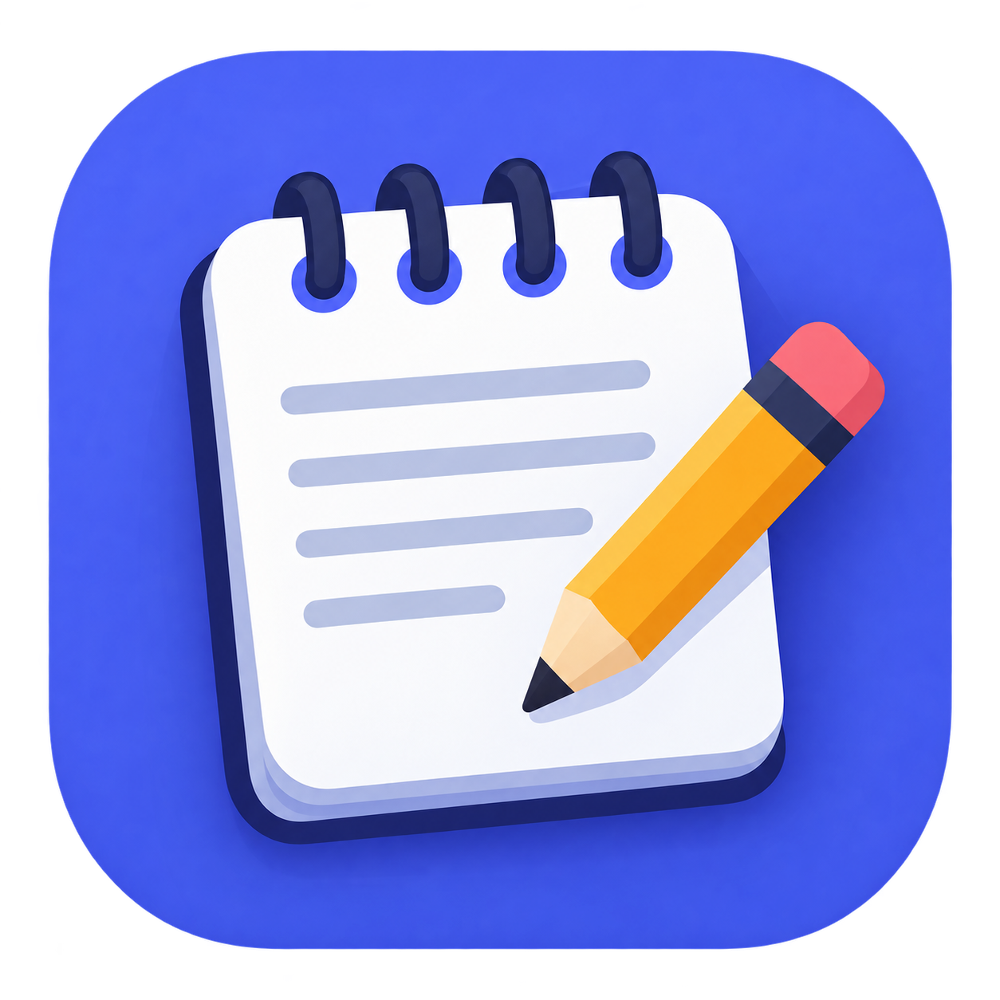
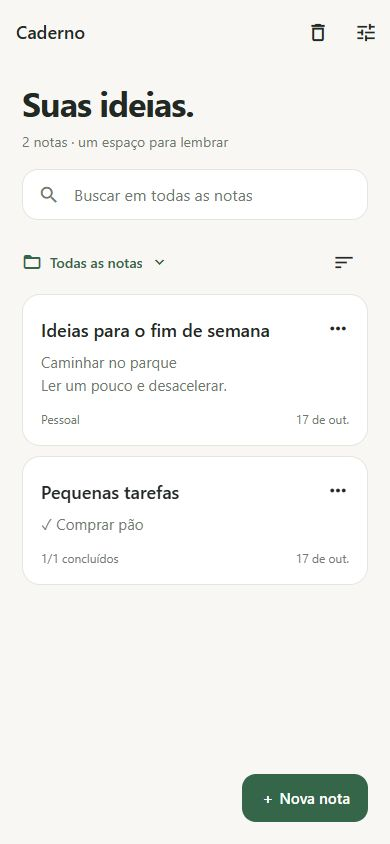

<div align="center">



# Bloco de Notas

**Uma ideia, uma lista, um lugar para lembrar.**

Um caderno offline para Android, com visual minimalista e suas notas sempre à mão.

[](https://github.com/SamuelASDev/Bloco-de-notas/releases)
[](https://docs.expo.dev/versions/v57.0.0/)
[](https://www.typescriptlang.org/)
[](LICENSE)

[**Baixar APK**](https://github.com/SamuelASDev/Bloco-de-notas/releases) · [Reportar um problema](https://github.com/SamuelASDev/Bloco-de-notas/issues) · [Como executar](#executar-o-projeto)

</div>

---

## Sobre

O Bloco de Notas foi feito para guardar pensamentos, organizar pequenas tarefas e encontrar uma anotação sem complicação. Você abre, escreve e continua o dia.

As notas ficam no dispositivo. O aplicativo funciona offline, sem cadastro ou sincronização em nuvem, e permite exportar seus dados quando você quiser.

A distribuição para Android é feita diretamente pelo **GitHub Releases**, em formato **APK**.

## Uma olhada no app

<div align="center">
  
  <p><sub>Interface em tema claro com notas de exemplo. Também há tema escuro e opção de acompanhar o sistema.</sub></p>
</div>

## O que você pode fazer

|                               | Recursos                                                                                      |
| ----------------------------- | --------------------------------------------------------------------------------------------- |
| ✍️ **Escrever**               | Notas com título, salvamento automático e indicação do estado do salvamento.                  |
| ✅ **Planejar**               | Checklists com itens concluídos e contagem de progresso.                                      |
| 🗂️ **Organizar**              | Pastas, notas fixadas no topo, ordenação e seleção múltipla.                                  |
| 🔎 **Encontrar**              | Busca em todas as notas ou em uma pasta, sem diferenciar acentos e maiúsculas.                |
| ↩️ **Recuperar**              | Desfazer/refazer, até 20 versões anteriores por nota e lixeira com leitura completa.          |
| 💾 **Guardar uma cópia**      | Backup JSON, importação com mesclagem ou substituição e cópia local de recuperação.           |
| 📤 **Levar para outro lugar** | Copiar, compartilhar texto e exportar notas em `.txt`.                                        |
| 🎨 **Personalizar**           | Temas claro, escuro e automático, além de tamanho de texto ajustável.                         |
| 📱 **Acessar rapidamente**    | Widget Android para criar notas ou checklists e recebimento de textos pelo menu Compartilhar. |

## Instalar no Android

1. Abra a página de [Releases](https://github.com/SamuelASDev/Bloco-de-notas/releases).
2. Escolha uma versão e baixe o arquivo **`.apk`** na seção **Assets**.
3. Abra o arquivo no celular. Se o Android solicitar, permita a instalação de apps por esse navegador ou gerenciador de arquivos.
4. Conclua a instalação e abra o Bloco de Notas.

**O APK funciona por conta própria:** quem instala uma versão de distribuição não precisa de Expo Go, Node.js ou computador.

Para atualizar, baixe o APK da versão seguinte e instale sobre a versão existente. Faça um backup das notas antes de atualizar ou trocar de celular. A desinstalação pode remover os dados locais.

## Seus dados e backups

Em **Preferências**, você pode exportar um backup ou importar um arquivo anterior.

- **Mesclar:** mantém as notas atuais e adiciona as importadas. Notas com IDs em conflito são preservadas como cópias.
- **Substituir:** troca as notas e pastas atuais pelo conteúdo do backup.
- **Recuperar:** antes de importar, o app guarda uma cópia local dos dados atuais. Você pode restaurá-la ou exportá-la pela opção de recuperação.

O backup inclui notas, pastas, checklists, lixeira e histórico. Importar o mesmo arquivo repetidamente pode criar cópias. O limite de importação é **20 MB**, e as preferências atuais são mantidas na restauração.

A cópia de recuperação é substituída a cada importação e fica no próprio dispositivo. Para proteger seus dados em caso de perda do celular ou desinstalação, guarde também um backup fora do app.

<details>
<summary><strong>Detalhes do armazenamento</strong></summary>

As notas são armazenadas com AsyncStorage. As gravações passam por uma fila para evitar conflitos entre operações. O editor salva após uma pausa de 350 ms na digitação, verifica alterações a cada 2 segundos durante digitação contínua e solicita salvamento ao sair ou ir para segundo plano.

Um encerramento forçado pode interromper alterações ainda não persistidas. O app e os arquivos exportados não implementam criptografia própria.

A primeira abertura migra as antigas chaves `notas` e `pastas` para `notebook:v2`, preservando os registros originais. Backups antigos sem versão continuam aceitos quando seus registros são válidos. O formato atual de backup é a versão 2.

</details>

## Executar o projeto

Você precisa de **Git, Node.js 22.13 ou superior compatível com o SDK 57 e npm**.

```sh
git clone https://github.com/SamuelASDev/Bloco-de-notas.git
cd Bloco-de-notas
npm ci
```

### No navegador

```sh
npm run web
```

### No celular com Expo Go

```sh
npx expo start --go
```

Abra o Expo Go no Android e escaneie o QR Code. Computador e celular devem estar na mesma rede. Se a conexão local não funcionar, use:

```sh
npx expo start --go --tunnel
```

O Expo Go permite experimentar as telas principais. **Widget e recebimento de textos de outros apps exigem um build Android próprio.**

### Com um cliente de desenvolvimento

```sh
npx eas-cli@latest build --platform android --profile development
```

Instale o APK gerado e inicie o servidor:

```sh
npx expo start --dev-client
```

Esse perfil é destinado ao desenvolvimento e depende do servidor para carregar o projeto durante os testes.

## Gerar o APK para o GitHub Releases

O perfil **`preview`**, já configurado em [eas.json](eas.json), gera um APK de distribuição com o código do aplicativo incluído.

```sh
npx eas-cli@latest login
npx eas-cli@latest build --platform android --profile preview
```

Ao terminar o build:

1. Baixe o APK pelo link fornecido pelo EAS.
2. Instale e teste no Android, incluindo widget, compartilhamento e backup.
3. No GitHub, crie uma release com uma tag, por exemplo `v1.0.0`.
4. Anexe o APK em **Assets**, escreva as novidades e publique a release.

Para disponibilizar o aplicativo aos usuários, use o **APK do perfil `preview`**. O perfil `development` contém ferramentas de desenvolvimento; o perfil `production` atual gera o formato padrão para lojas, AAB.

Nas próximas versões, mantenha o identificador Android e a chave de assinatura, e incremente o `versionCode`. Isso permite instalar atualizações sobre o app existente. Preserve uma cópia segura das credenciais de assinatura e nunca as inclua no repositório.

Referências: [geração de APK com EAS](https://docs.expo.dev/build-reference/apk/) e [assinatura de aplicativos Android](https://developer.android.com/studio/publish/app-signing).

## Qualidade e testes

```sh
npm run lint
npm run typecheck
npm test
npx expo-doctor
```

Os testes automatizados cobrem migração de dados, validação de backups, gravações concorrentes, falhas de armazenamento, recuperação, mesclagem e a proteção do registro do widget quando o módulo nativo não está disponível.

Antes de publicar um APK, confira no aparelho:

- Digitação rápida, retorno à lista e reabertura da nota.
- Salvamento ao alternar para outro aplicativo.
- Criação e edição de checklists, desfazer/refazer e histórico.
- Movimentação por pastas, seleção múltipla e restauração pela lixeira.
- Exportação, mesclagem, substituição e recuperação de backups.
- Temas, fontes ampliadas, TalkBack e comportamento do teclado.
- Widget e recebimento de textos compartilhados por outros apps.

## Como o projeto está organizado

```text
src/
├── app/                    # Telas e navegação com Expo Router
├── components/
│   └── notebook-ui.tsx     # Componentes e paleta compartilhados
├── data/
│   ├── model.ts            # Tipos, validação e mesclagem de backups
│   ├── store.ts            # Estado compartilhado e fila de gravações
│   ├── files.ts            # Importação e exportação
│   └── dialog.ts           # Confirmações e mensagens
└── widgets/                # Widget Android e tarefa em background

tests/                      # Testes com o runner do Node.js
docs/images/                # Imagens da documentação
```

Construído com **Expo SDK 57**, **React Native**, **TypeScript**, **Expo Router** e **AsyncStorage**.

## Contribuir

Encontrou um problema ou teve uma ideia? [Abra uma issue](https://github.com/SamuelASDev/Bloco-de-notas/issues) contando o que aconteceu ou o que você gostaria de melhorar.

Pull requests são bem-vindos. Para mudanças maiores, abra uma issue antes para alinhar a proposta. Ao contribuir, execute lint, typecheck e testes.

## Licença

Este projeto está disponível sob a [licença MIT](LICENSE).

Desenvolvido por [SamuelASDev](https://github.com/SamuelASDev).
